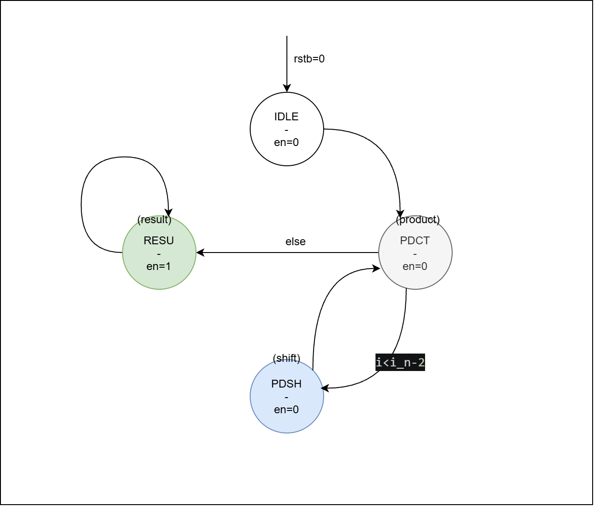
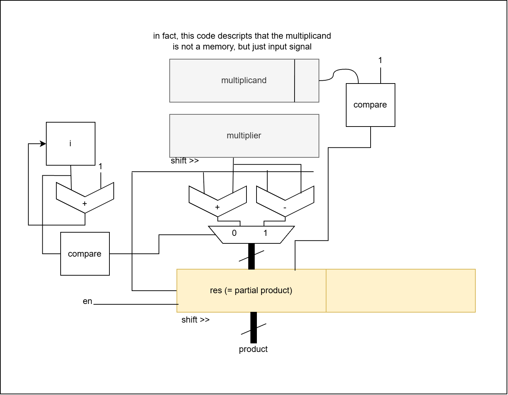

# Adder & Multiplier

## Adder

- default: Q3.3 + Q3.3 -> Q5.1
- signed를 가정함.
- integer bits와 fraction bits 모두 `parameter`
> 단, 입력 fraction bits >= 출력 fraction bits 여야함.

## Multiplier

- signed를 가정함.

아래는 FSM, schema이다.

