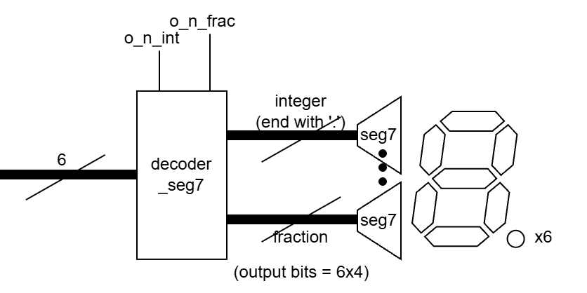

# Verilog HDL Modules

간단한 모듈 이것저것 올리는 겸, 지수랑 log 함수 지원하는 계산기까지 달려보자.

## List

### Adder
> so easy to implemet. 

### Decoder(7-segments display)
> DE10-Lite의 6개 7-segments display를 기준.

### Multiplier
> partial product (중간 누적합) 방식으로 구현.

